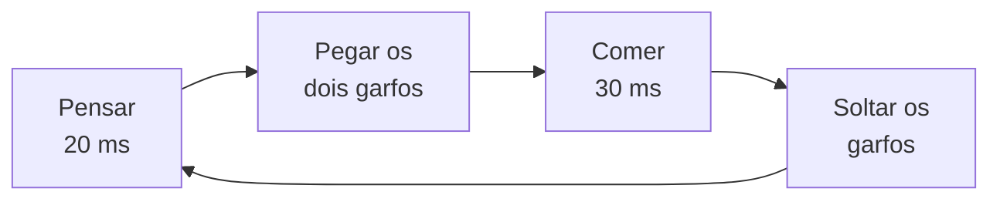
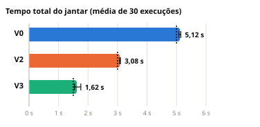
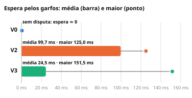
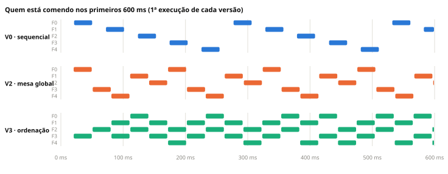

<div align="center">

# 🍝 Filósofos Jantando em Go

**FPPD · Trabalho 1 · Concorrência e Sincronização**


Quatro implementações do problema clássico de Dijkstra para comparar **corretude**
(deadlock, starvation) e **desempenho** de diferentes estratégias de sincronização.

[📄 Relatório (PDF)](relatorio/relatorio.pdf) · [📊 Resultados](resultados/) · [▶️ Como executar](#como-executar)

</div>

---

## O problema

Cinco filósofos sentam em volta de uma mesa com um garfo entre cada par. Para comer,
cada um precisa dos **dois garfos ao seu lado**, e cada garfo é disputado por dois
vizinhos. Cada filósofo repete o ciclo abaixo **20 vezes**:



Os tempos mantêm a proporção 2:3 do `filo_seq.go` de referência do Prof. De Rose,
em milissegundos em vez de segundos.

## As quatro versões

| Versão | Pasta | Estratégia | Deadlock? | Máx. comendo junto |
| :---: | --- | --- | :---: | :---: |
| **V0** | [`v0-sequencial/`](v0-sequencial/main.go) | Sequencial: um filósofo depois do outro (linha de base) | impossível | 1 |
| **V1** | [`v1-deadlock/`](v1-deadlock/main.go) | Um `sync.Mutex` por garfo; todos pegam esquerdo → direito | **sim** | 0 |
| **V2** | [`v2-mesa/`](v2-mesa/main.go) | V1 + um mutex global ("mesa"): só um filósofo por vez | não | 1 |
| **V3** | [`v3-ordenacao/`](v3-ordenacao/main.go) | V1 + ordenação: sempre o garfo de menor número primeiro | não | 2 |

Todas as versões compartilham o mesmo ciclo (`umCiclo`) e a mesma coleta de métricas.
Entre V1, V2 e V3, **só mudam as funções `pegarGarfos` e `soltarGarfos`**:

<table>
<tr><th>V1 · trava</th><th>V2 · mesa global</th><th>V3 · ordenação</th></tr>
<tr valign="top">
<td>

```go
garfos[esquerdo].Lock()
garfos[direito].Lock()
// se todos pegaram o
// esquerdo, ninguém
// consegue o direito
```

</td>
<td>

```go
mesa.Lock() // um por vez
garfos[esquerdo].Lock()
garfos[direito].Lock()
// mesa.Unlock() só depois
// de soltar os garfos
```

</td>
<td>

```go
if primeiro > segundo {
    // só o F4 inverte
    primeiro, segundo =
        segundo, primeiro
}
garfos[primeiro].Lock()
garfos[segundo].Lock()
```

</td>
</tr>
</table>

| | Por que trava ou não trava |
| --- | --- |
| **V1** | As 4 condições de Coffman valem: exclusão mútua, posse e espera, ausência de preempção e espera circular (F0 espera F1, …, F4 espera F0). |
| **V2** | Só quem tem a mesa disputa garfos, então nunca se forma um ciclo de espera. O custo: no máximo 1 filósofo come por vez. |
| **V3** | Com uma ordem global, ninguém segura um garfo maior esperando um menor, e o ciclo não fecha. Até 2 filósofos comem juntos. |

## Resultados

Médias de **30 execuções** por versão (6 rodadas do programa × 5 execuções):

| Métrica | V0 | V1 | V2 | V3 |
| --- | :---: | :---: | :---: | :---: |
| Tempo total | 5,12 s | trava | 3,08 s | **1,62 s** |
| Espera média pelos garfos | 0,0 ms | infinita | 99,7 ms | 24,5 ms |
| Maior espera observada | 0,5 ms | infinita | 125,0 ms | 151,5 ms |
| Máx. comendo ao mesmo tempo | 1 | 0 | 1 | **2** |
| Ciclos por filósofo | 20 | 0 | 20 | 20 |

<p align="center">
  
  
</p>

<p align="center">
  
</p>

**Principais conclusões**

- A **V3** foi 3,2× mais rápida que a V0 e 1,9× mais rápida que a V2, com 2 filósofos comendo ao mesmo tempo (o máximo possível com 5 garfos).
- A **V2** é correta, mas transforma o jantar numa fila: a espera média é 4× a da V3. Ainda assim supera a V0, porque *pensar* continua em paralelo.
- Sem o atraso de demonstração, a **V1** travou em 17 de 50 execuções, sempre no 1º ciclo, quando todos ficam com fome ao mesmo tempo.
- Com um único núcleo (`GOMAXPROCS=1`) os tempos não pioram: o gargalo são os garfos, não a CPU.

A análise completa, com as 12 questões do enunciado, está no [relatório](relatorio/relatorio.pdf).

## Como executar

Requer **Go 1.22 ou mais novo**. Na raiz do repositório:

```bash
go run ./v0-sequencial    # ~5 s por execução
go run ./v1-deadlock      # trava de propósito: "fatal error: all goroutines are asleep - deadlock!"
go run ./v2-mesa          # ~3 s por execução
go run ./v3-ordenacao     # ~1,6 s por execução
```

Cada programa (exceto a V1) faz 5 execuções e imprime:

- o ambiente (versão do Go, sistema operacional, núcleos);
- a linha do tempo da 1ª execução, com o instante de cada evento (`P` = pensando, `C` = comendo);
- as métricas de cada execução e a média;
- a espera por filósofo, para analisar starvation;
- as linhas em CSV, prontas para uma planilha.

Na V1, um atraso de 10 ms entre pegar o garfo esquerdo e o direito faz o deadlock
acontecer sempre. Para ver o comportamento "natural", troque `atrasoEntreGarfos` para `0`.

## Reproduzir os experimentos e o relatório

Requer **Python 3** com `pygments` e o **Google Chrome** (usado para gerar o PDF).

```bash
py relatorio/experimentos.py      # roda a bateria completa (~8 min) e grava resultados/*.csv
py relatorio/gerar_relatorio.py   # gera os gráficos e o relatorio.pdf a partir dos dados
```

A bateria inclui o cenário base (30 execuções por versão), dois cenários extras de carga
(pensar/comer = 40/10 e 10/40 ms), um teste com `GOMAXPROCS=1` e 60 execuções da V1
com e sem o atraso.

## Estrutura do repositório

```text
fppd-t1-filosofos/
├── v0-sequencial/main.go     V0 · sequencial (linha de base)
├── v1-deadlock/main.go       V1 · concorrente sujeita a deadlock
├── v2-mesa/main.go           V2 · sem deadlock, sincronização excessiva
├── v3-ordenacao/main.go      V3 · concorrente aprimorada
├── resultados/               saídas oficiais e CSVs de todas as execuções
├── relatorio/
│   ├── relatorio.pdf         relatório final
│   ├── figuras/              gráficos em SVG
│   ├── experimentos.py       bateria de experimentos
│   └── gerar_relatorio.py    gera gráficos e PDF a partir dos dados
└── go.mod
```

## Ambiente de testes

| | |
| --- | --- |
| Linguagem | Go 1.27.0 (windows/amd64) |
| Sistema | Windows 11 |
| Processador | Intel Core i7-13700H · 14 núcleos / 20 threads |

## Grupo

| Integrante |
| --- |
| Eduardo Pacheco Lobo |
| Igor Xavier Nunes |
| Rodrigo Fehlauer Lauermann |
